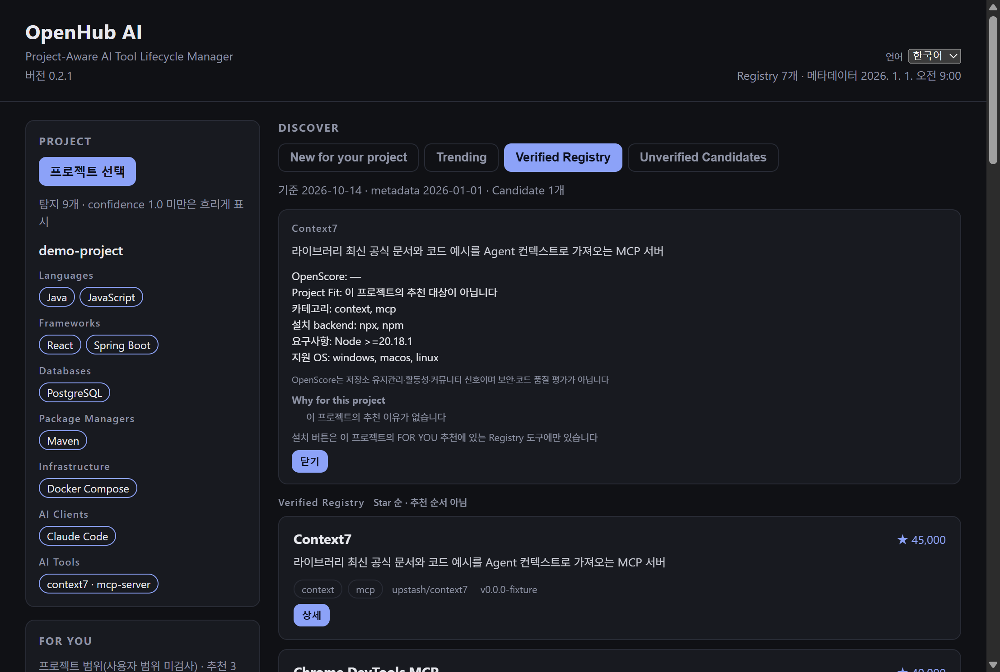

# OpenHub AI

OpenHub AI is a desktop app (and CLI) that looks at your project, suggests MCP servers for your AI coding client (Claude Code, Codex or Cursor), and installs them for you after you review and approve exactly what will change. It can also check that an installed server starts, update it, roll it back, and show what it changed.



## Download

Get the files from the [latest release](https://github.com/kanghyunsoon/openhub-ai/releases/latest):

| Your computer | File |
| --- | --- |
| Windows 10/11, x64 | `OpenHub-AI-Setup-<version>-x64.exe` |
| Linux x64 with a desktop session | `OpenHub-AI-<version>-x86_64.AppImage` |
| macOS | No download. You can build from source (see [Supported platforms](docs/supported-platforms.md)). |

Also download `SHA256SUMS` and compare the file before you run it. This only shows that your download is identical to the file published on the release page (not damaged or swapped in transit). It does **not** prove who built it and is not a malware scan: `SHA256SUMS` comes from the same release page.

```powershell
# Windows (PowerShell): the printed hash must equal the line for this file in SHA256SUMS
Get-FileHash .\OpenHub-AI-Setup-<version>-x64.exe -Algorithm SHA256
```

```sh
# Linux
sha256sum -c SHA256SUMS --ignore-missing
```

## What You Need

The app itself needs nothing else. Each MCP server, however, is started by a program that must already be installed. You only need the program for the tools you actually install. The check commands below only print the version of a program you installed yourself; they do not run any MCP server. OpenHub runs an MCP server (third-party code) only after you approve a plan: to prepare it, to check its Health, or to benchmark it.

| To install | You need | Check with |
| --- | --- | --- |
| Context7, Playwright MCP, Chrome DevTools MCP, MongoDB MCP Server, Kubernetes MCP Server (and Memory MCP in v0.2.0 only, see below) | [Node.js](https://nodejs.org/) (includes npm and npx) | `npx --version` |
| Postgres MCP Pro (and Serena in v0.2.0 only, see below) | [uv](https://docs.astral.sh/uv/) (provides uvx) | `uvx --version` |
| GitHub MCP Server (and Postgres MCP Pro if uv is missing) | [Docker](https://docs.docker.com/get-docker/), running | `docker info` |

You also need at least one AI client: Claude Code, Codex or Cursor. If a required program is missing, the install plan says which backend was not found and nothing is changed.

## Install

**Windows.** Run `OpenHub-AI-Setup-<version>-x64.exe`. The installer is **unsigned**, so Windows SmartScreen or Smart App Control may warn before it runs ("Windows protected your PC"). If the file was downloaded with a browser, Windows may instead or also show "Open File - Security Warning" with *Publisher: Unknown Publisher*. An unsigned installer cannot prove who published it. Run it only if you downloaded it yourself from this repository's release page and the SHA256 matches; if you are unsure, do not run it (you can use the CLI package or build from source instead). Windows offers *More info* → *Run anyway* (SmartScreen) or *Run* (security warning); whether to use it is your decision, and organisations may block it. Start OpenHub AI from the Start menu.

**Linux.** Make the AppImage executable and run it:

```sh
chmod +x OpenHub-AI-<version>-x86_64.AppImage
./OpenHub-AI-<version>-x86_64.AppImage
```

If it does not start because FUSE is missing on your distribution, run it with `--appimage-extract-and-run`.

## First 5 Minutes

1. **Language.** The app starts in your system language when it is English or Korean (otherwise English). Change it any time with *Language*; the choice is kept after restart.
2. **PROJECT → Choose project.** Pick your project folder (not your home folder). OpenHub only reads manifests and config files such as `package.json`, `pom.xml`, `pyproject.toml` and existing MCP settings. It runs nothing in your project.
3. **FOR YOU.** Each recommendation shows *why* (which file showed which technology, and which capability is missing), Project Fit, and OpenScore. OpenScore reflects repository maintenance, activity and community signals; it is not a security or code-quality rating. If nothing is recommended, the screen explains why (stack not recognized, no rule, tool already used, client or OS not supported).
4. **Install.** Choose the clients (Claude Code, Codex, Cursor) and the scope. *Project* (default) writes only this project's files; *User* writes files in your home folder and affects every project, so it needs an extra approval.
5. **Review the plan.** It lists the exact command, every file that will change, any download, and the items you are agreeing to. Nothing runs before you approve in the confirmation dialog. If anything changes between the plan and the run, it stops with `PLAN_STALE` and you review again.
6. **INSTALLED.** The tool appears with its version. *Health Check* starts the MCP server briefly in a temporary folder and checks that it answers. *Update* and *Roll back to previous version* work the same way: plan, approval, run, Health.

Tools that need a secret (for example `GITHUB_PERSONAL_ACCESS_TOKEN` or `DATABASE_URI`) show the variable name in the plan. OpenHub never asks for, reads or stores the value; set it in the environment your client uses.

## What OpenHub Changes on Your Computer

| File | When |
| --- | --- |
| `.mcp.json` (Claude Code), `.cursor/mcp.json`, `.codex/config.toml` in your project | Project-scope install, update, rollback, repair. Only the one server entry; other entries are kept as they are. JSON files are written back with indentation, so a file that was on one line becomes several lines; the content of the other entries does not change. |
| `~/.cursor/mcp.json`, `~/.codex/config.toml` | Only for user-scope installs you approve. `~/.claude.json` is never written. |
| `~/.openhub/state/` | OpenHub's own records: Version State, operation records, locks. |
| `~/.openhub/tool-config/` | Only for tools with an OpenHub-managed config (Kubernetes MCP Server). |
| npm and uv caches | Packages downloaded for exact versions (npx and uvx tools). OpenHub never deletes cache entries. |

## When Something Goes Wrong

| You see | What it means and what to do |
| --- | --- |
| *backend not found* / *BACKEND_UNAVAILABLE* | The program for this tool (Node.js, uv or Docker) is not installed or not on PATH. Install it (see What You Need), restart OpenHub, plan again. Nothing was changed. |
| `PLAN_STALE` | A file, version or setting changed after you approved. Review the new plan and approve again. |
| Health failed | The server did not start or answer in time. For an update or rollback, the previous configuration is restored and Version State is not changed. Check required environment variables, Docker running, then try again. |
| *interrupted-update* | An update, rollback or repair stopped midway (app closed or killed). Other operations on that tool are blocked until it is recovered. From v0.2.1, recover with the CLI (`openhub lifecycle recover <toolId>`); INSTALLED shows the exact command. v0.2.0 has no recovery command: fix the entry by hand as described in the [v0.2.0 known issues](docs/known-issues-v0.2.0.md). See [Troubleshooting](docs/troubleshooting.md). |
| `OPERATION_IN_PROGRESS` | Another OpenHub window or terminal is changing tools. Wait and retry. |

Run `openhub doctor` (CLI) to see which programs were found. More in [Troubleshooting](docs/troubleshooting.md).

## Removing a Tool or OpenHub

There is no remove command yet. To stop using a tool OpenHub installed:

1. Close the AI client and any OpenHub window.
2. **Make a copy of the configuration file first** (for example copy `.mcp.json` to `.mcp.json.bak`), so you can put it back if something goes wrong.
3. Open the configuration file shown in INSTALLED and delete only that server's entry:
   - JSON files (`.mcp.json`, `.cursor/mcp.json`, `~/.cursor/mcp.json`): delete the `"<name>": { … }` member under `mcpServers` and fix the comma between the remaining members. Make sure the file is still valid JSON.
   - TOML files (`.codex/config.toml`, `~/.codex/config.toml`): delete the `[mcp_servers.<name>]` header line and every line after it up to (not including) the next `[...]` header, plus any sub-tables of that server such as `[mcp_servers.<name>.env]`. Do not touch other `[mcp_servers.…]` tables.
4. OpenHub keeps its own record, so INSTALLED and `openhub lifecycle status` now show `missing-config` for that tool. This is expected and harmless. Installing the tool again later works and clears it.

This procedure was checked against the current code: the other entries stay byte-for-byte the same, the removed tool shows `missing-config`, and a later install returns it to `state-consistent`.

To remove the app: on Windows use *Settings → Apps → OpenHub AI → Uninstall*; on Linux delete the AppImage file. Your client configuration files are not changed by uninstalling. OpenHub's records stay in `~/.openhub`; delete that folder if you want to remove them too. The app's own data (browser cache and the language you chose) also stays, in `%APPDATA%\@openhub\desktop` on Windows and `~/.config/@openhub/desktop` on Linux (`$XDG_CONFIG_HOME/@openhub/desktop` if you set `XDG_CONFIG_HOME`); delete that folder too if you want. Close OpenHub AI before deleting either folder.

## Supported Clients and Verification

| Client | What OpenHub writes |
| --- | --- |
| Claude Code | Project scope (`.mcp.json`). No user scope. |
| Codex | Project and user scope. |
| Cursor | Project and user scope. |

"Installs" and "verified to run" are different things. OpenHub writes the configuration for all three clients, but it has actually started a tool *from the client's configuration* only in these cases: Kubernetes MCP Server with Claude Code and Codex on Windows and Linux. Cursor is **not verified** on Windows and Linux; nothing is verified on macOS. The app shows the verification level per client and OS before you install. Details: [Supported platforms](docs/supported-platforms.md).

Pinokio support targets pterm 0.0.25. Default tests use a fake pinokiod; real Pinokio integration runs only when OPENHUB_E2E=1. OpenHub never runs third-party Pinokio scripts; it only shows them.

## Known Issues

Read the [known issues for v0.2.0](docs/known-issues-v0.2.0.md) before you start: switching projects during install, interrupted updates, Postgres MCP Pro on a new machine, and the slow first start of uvx tools on Windows. The limits of the unreleased code on `main` are in the [v0.2.1 known issues](docs/known-issues-v0.2.1.md).

The download is v0.2.0. This README also describes the code on `main`, which is not released yet. Differences:

| | v0.2.0 (current release) | v0.2.1 (not released) |
| --- | --- | --- |
| Interrupted update, rollback or repair | Manual fix of the entry (see known issues) | `openhub lifecycle recover <toolId>` (CLI), with approval |
| Desktop guidance for an interrupted operation | Not detected as interrupted (shows config-drift) | Exact command, how to get the CLI, how to confirm |
| Two OpenHub windows or terminals changing tools at once | Can lose a record | One change at a time (`OPERATION_IN_PROGRESS`) |
| Environment passed to MCP servers during Health and Benchmark | Your whole environment | Only OS and path variables, proxy/CA and the backend's own settings, and the variables the tool declares. If a package index or registry setting in your environment cannot be passed as-is (for example a URL with credentials), Health and Benchmark do not run; put it in `uv.toml` or `.npmrc` instead ([security model](docs/security-model.md)) |
| First start of Postgres MCP Pro on Windows | Can hit the Health time limit | The exact version (`postgres-mcp==0.3.0`, `mcp==1.30.0`, wheels only) is prepared before the configuration is written; the client also runs it with `--no-build` |
| Serena | Installable; the client builds a dependency (`proxy-tools`) from source on first start | **No new installs, updates, rollback, Health, repair, adopt or Benchmark**: that build cannot be verified. An existing Serena entry and its Version State are kept and shown as withdrawn; an interrupted operation can still be recovered; remove it with [the manual steps](#removing-a-tool-or-openhub) if you want. Re-support: [#59](https://github.com/kanghyunsoon/openhub-ai/issues/59) |
| Memory MCP | Installable; memories are stored in `memory.jsonl` inside the npx cache by default | **No new installs, updates, rollback, Health, repair, adopt or Benchmark**: a new upstream version deletes that file, and another version starts without the earlier memories. An existing entry, its Version State and the memory file are kept and shown as withdrawn; an interrupted operation can still be recovered. Your client can still start it and OpenHub does not protect the file for you: back up `memory.jsonl` and set `MEMORY_FILE_PATH` to an absolute path outside the npm cache ([known issues](docs/known-issues-v0.2.1.md)). Storage fix: [#69](https://github.com/kanghyunsoon/openhub-ai/issues/69) |
| Context7 | Unpinned; the first Health downloads the newest version within the 20 s startup limit (about 15.8 s on one Windows PC with an empty npm cache) | Pinned to `@upstash/context7-mcp@4.1.0` and prepared after approval, before the configuration is written. Existing entries keep their command until you update them ([known issues](docs/known-issues-v0.2.1.md)) |
| First Health of unpinned npx tools (Chrome DevTools MCP, Playwright MCP) | Downloads the package within the 20 s startup limit | Unchanged and not measured. Run Health again after `startup-timeout` ([known issues](docs/known-issues-v0.2.1.md), [#70](https://github.com/kanghyunsoon/openhub-ai/issues/70)) |

## Demo

`pnpm demo` walks through the whole flow on the bundled [demo project](examples/demo-project/) (React + Spring Boot + PostgreSQL + Claude Code): Analyze → Existing tools → Recommend → Install preview → Adopt → Releases → Impact → Update preview → Discover → Benchmark preview. The demo uses fixture data, makes no network requests and starts no processes. Install, update and benchmark stop at the plan: the demo declines the approval.

## Core Features

- **Project analysis**: languages, frameworks, databases, infrastructure and AI clients from manifests and config files. Read-only.
- **Recommendations**: capability gaps ranked by Project Fit, with OpenScore shown separately.
- **Installation**: npx, uvx and Docker backends with targeted config edits and a plan digest you approve.
- **Lifecycle**: Version State, artifact locks, MCP health checks, updates that are reverted if the health check fails, rollback with its own approval.
- **Adopt**: register MCP servers you already configured, without changing the file.
- **Release intelligence**: release notes, a deterministic summary (Breaking, Security, Compatibility, Performance, Fix, Other) and an update impact verdict. An optional AI summary is display-only.
- **Discover**: New for your project, Trending, the Verified Registry and Unverified Candidates. About Trending: Not historical star growth: a deterministic score combining current popularity with recent release and repository activity. It does not rate security or code quality. Candidates are UNVERIFIED drafts and can never be installed, adopted or updated.
- **Benchmark**: start an MCP server six times and measure startup, initialize and tools/list times, after approval and without calling any tool.

## How It Works

Discover → Recommend → Install → Verify → Update → Rollback

1. **Discover**: the project scanner builds a profile with evidence; the Registry provides the candidates.
2. **Recommend**: gaps are matched against Registry tools and explained.
3. **Install**: a plan lists the exact command, the config files it writes and the approvals it needs. It is rebuilt right before execution; if anything changed, it stops with `PLAN_STALE`.
4. **Verify**: Prepared, Configured and Detected states, plus an MCP health check in an isolated temporary directory.
5. **Update**: the new version is pinned, the entry is replaced, the health check runs, and Version State changes only if it passes. Otherwise the previous entry is restored.
6. **Rollback**: returns to the previous revision with a separate plan and approval.

## Security and Approval Model

- Every change goes through a plan, a human approval and a re-check right before execution. There is no `--yes` or auto-approve option.
- Commands run without a shell. Config edits are targeted, atomic and reverted on failure.
- Secrets are never stored: plans, results and logs contain environment variable names, not values.
- Recommendations, scores, release notes and AI summaries are information, not approval.

Release artifacts come with CycloneDX SBOMs and `SHA256SUMS`. Syft finds no components in the Linux AppImage or the CLI package and cannot read inside Electron's app.asar; bundled JavaScript dependencies are covered by the dependency SBOMs. Because the Windows executable is branded as OpenHub AI, Syft may not identify it as Electron; the Electron version is verified from the dependency SBOM, the running app and the official Electron distribution.

See [Security model](docs/security-model.md), [Approval model](docs/approval-model.md), [Discovery trust](docs/discovery-trust.md), [LLM privacy](docs/llm-privacy.md) and [Release process](docs/release-process.md).

## CLI

The CLI is the `openhub-ai-<version>.tgz` file in the release. It needs Node.js 24.15 or later:

```sh
npm install -g ./openhub-ai-<version>.tgz
openhub --version
openhub doctor
openhub project recommend ./my-project
```

| Command | What it does |
| --- | --- |
| `openhub project scan <path>` | Project profile with evidence |
| `openhub project recommend <path>` | Recommendations with reasons; installs nothing |
| `openhub install <toolId>` | Install plan → approval → install |
| `openhub lifecycle status` | Version State, drift and health of installed tools |
| `openhub update <toolId>` / `openhub rollback <toolId>` | Update or roll back with health check |
| `openhub lifecycle health <toolId>` | Approved health check |
| `openhub lifecycle recover <toolId>` | Review and approve recovery of an interrupted operation (v0.2.1 and later) |
| `openhub adopt <toolId>` | Register an already configured tool |
| `openhub releases <toolId>` / `openhub impact <toolId>` | Release notes, summary, update impact |
| `openhub discover --view trending` | Discover views |
| `openhub benchmark <toolId>` | Approved startup benchmark, no tool calls |
| `openhub doctor` | Environment, backends, Registry and Version State check |

Run `openhub --help` for every option.

## Desktop

Four areas: **PROJECT** (choose and analyze a folder), **FOR YOU** (recommendations and install plans), **DISCOVER** (New for your project, Trending, Verified Registry, Unverified Candidates, tool details) and **INSTALLED** (status, updates, health checks, rollback, Adopt, Benchmark, release notes and Pinokio previews). A short guide appears until you pick a project. Approvals are native dialogs.

## Architecture

A TypeScript monorepo: `packages/core` holds the analyzer, Registry, recommendation, installer, lifecycle and release logic; `apps/cli` and `apps/desktop` (Electron) are thin front ends over it; `registry/` holds the curated Manifests. See [Architecture](docs/architecture.md), the [Roadmap](docs/roadmap.md) and the [specs](docs/specs/). Build from source with `pnpm install`, `pnpm test`, `pnpm desktop`.

## Contributing

Contributions to the code and to the Registry are welcome. See CONTRIBUTING.md for the development setup, tests and the Candidate → Manifest process, and SECURITY.md for reporting vulnerabilities.

## License

MIT. See [LICENSE](LICENSE) and [THIRD_PARTY_NOTICES.md](THIRD_PARTY_NOTICES.md).
